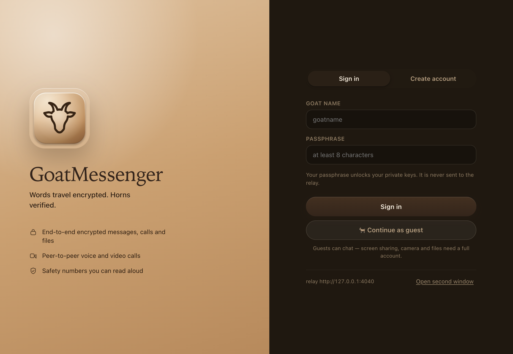
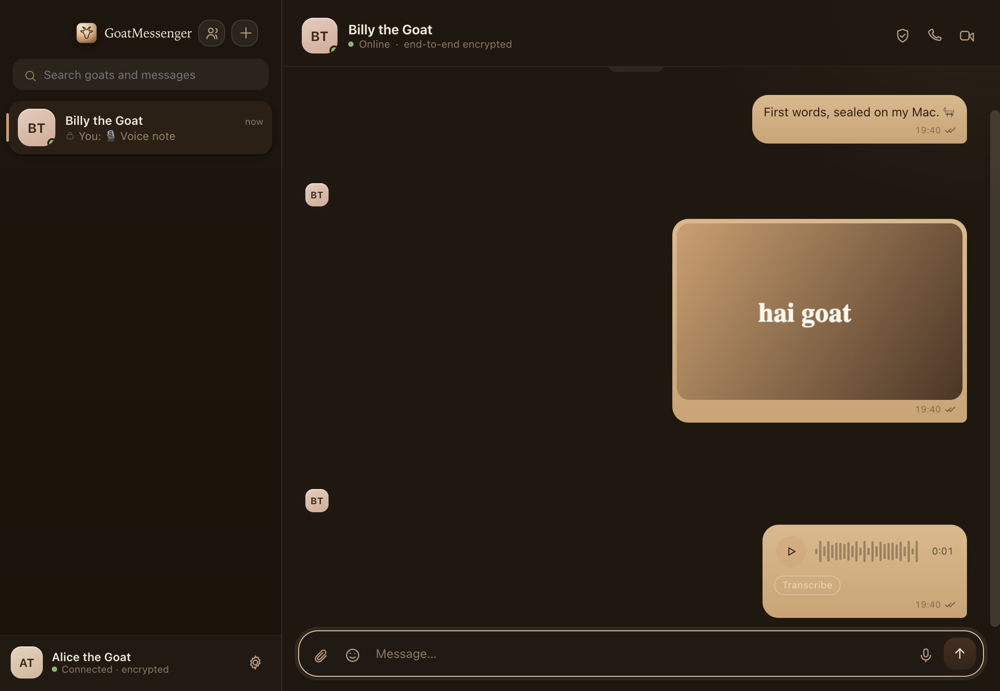

# GoatMessenger 🐐

An end-to-end encrypted desktop messenger for macOS, built around the goat logo in this
repo: espresso line-work on camel, cream paper, warm serif headings.



## What it does

- **Accounts** — create an account with a goat name and passphrase, sign in on any window,
  sign out. Your passphrase derives your keys locally; the relay only ever receives an
  authentication token and an encrypted key backup.
- **End-to-end encrypted messaging** — X3DH key agreement and a full Double Ratchet
  (per-message keys, DH ratchet turns, out-of-order + replay handling). Text never leaves
  the machine in the clear.
- **Encrypted attachments** — images, files and recorded voice notes are encrypted on the
  sender's Mac with a one-off AES-256-GCM key; the key travels inside the encrypted message,
  the relay stores only ciphertext.
- **Voice and video calls** — real peer-to-peer WebRTC. Signalling is sealed under a call key
  derived from signed ephemeral key pairs, media is DTLS-SRTP between the two peers, and both
  sides see the same six-digit call security code.
- **A TURN relay you own** — a bundled RFC 5766 TURN server, so calls still connect when both
  ends sit behind strict NATs. It forwards only the already-encrypted SRTP stream: the relay
  can measure your call, but it can never listen to it.
- **Safety numbers** — a 60-digit fingerprint per conversation that you can read aloud and
  mark as verified.
- **The rest of a messenger** — presence, typing indicators, read receipts, unread badges,
  day dividers, chat + message search, profile editing, encrypted history on disk.



## Run it

Two ways, both local:

```bash
# 1. double-click the built app
open dist/GoatMessenger.app

# 2. or run from source
npm install
npm start
```

The app starts its own relay (a small Node server) on `127.0.0.1:4040`, or the next free port
if 4040 is taken — the port in use is shown at the bottom of the sign-in screen. Everything
is stored on this Mac, in `~/Library/Application Support/goatmessenger`.

All of the goat branding — the Dock icon, the sign-in logo, even the code used to render
them — comes from one artwork: `npm run icon` re-renders `build/goatmessenger.icns`,
`build/goatmessenger.ico` and `app/assets/icon.png` from `build/original-logo.png`. Running
from source stamps the goat into the Dock automatically (packaged builds carry it in the
bundle).

### Windows build

The Windows build is produced on this same Mac — no Wine, no Windows VM:

```bash
npm run package:win
# → dist/GoatMessenger-win32-x64/  +  dist/GoatMessenger-win32-x64.zip
```

On Windows, extract the zip and double-click `GoatMessenger.exe`. The goat icon is embedded
into the exe's own resources (Explorer, shortcuts, taskbar) and the window icon comes from
`app/assets/goatmessenger.ico` inside the app folder. The build reuses the win32 Electron
runtime zip (`electron-v33-win32-x64.zip`), which is fetched once into the Electron cache and
reused afterwards.

### Trying calls by yourself

1. Create an account, e.g. `billy`.
2. Open a second window (**⌘⇧N**, the menu, or “Open second window” on the sign-in screen).
3. Create a second account in that window, e.g. `nanny`.
4. Add each other by goat name, accept the request, then hit the 📞 or 🎥 button.

The first call may ask for microphone/camera permission — macOS remembers it afterwards.

### TURN, when you need it

Calls prefer a direct peer-to-peer route and use TURN only when they have to (or when you
force it). On a closed network (hotel wifi, corporate firewalls, two Macs on different
continents both behind strict NATs) a TURN relay is what makes the call connect at all:

```bash
# run the relay + TURN together on a box with a public address
npm run server                       # in one terminal (relay on 127.0.0.1:4040)
TURN_PORT=3478 TURN_PUBLIC_IP=203.0.113.10 TURN_USER=goat TURN_PASS='a-good-secret' node server/index.js

# then in each app: Settings → Network → paste the relay URL and turn:203.0.113.10:3478
```

Environment knobs — the app's own relay turns TURN on itself with `GM_TURN_PORT`,
`GM_TURN_PUBLIC_IP`, `GM_TURN_USER`, `GM_TURN_PASS`, `GM_TURN_STATS_TOKEN`; a standalone
relay uses `TURN_PORT`, `TURN_PUBLIC_IP`, `TURN_USER`, `TURN_PASS`, `TURN_REALM`,
`TURN_STATS_TOKEN`. In the app you can also point at an external TURN server
(`GM_TURN_URL`/`GM_TURN_USER`/`GM_TURN_PASS`) or force every call through TURN with
`GM_FORCE_TURN=1`. The counters behind `/api/turn-stats?token=…` (token set by the
`*_TURN_STATS_TOKEN` variables) show allocations and packets forwarded.

The TURN server chews only opaque UDP: it cannot read SRTP packets, and it does not unseal
call signalling (that already happens between the peers under the call key). Media over TURN
is still your two Macs decrypting each other's stream — the relay in the middle just carries
bytes.

### Sharing a relay over the internet (tunnels)

If you don't have a public server, run the relay on your own machine and punch it through
with a tunnel (ngrok, Cloudflare Tunnel, …). Order matters: relay first, tunnel second.

```bash
npm run server        # keep this terminal running
npx ngrok http 4040
```

ngrok v3 has no local dashboard port, so it coexists with the relay on 4040 just fine —
but it must print a `https://…ngrok-free.dev` URL and keep running (its banner stays in
the terminal). That URL goes into **Settings → Network** on every device that should
share that relay.
The app sends ngrok's `ngrok-skip-browser-warning` header automatically, so free tunnels
work without their "Visit site" interstitial breaking the health checks.

## How the encryption works

| Piece | Choice |
| --- | --- |
| Identity | X25519 (DH) + Ed25519 (signing, authenticates the signed prekey and call handshakes) |
| Key agreement | X3DH with a signed prekey and a one-time prekey |
| Transport | Double Ratchet — one symmetric chain per direction plus a DH ratchet on every turn |
| Message AEAD | AES-256-GCM, per-message key + nonce derived from the ratchet, header authenticated as AAD |
| Attachments | Random AES-256-GCM key per file, key sent inside the E2EE message |
| Calls | Signed ephemeral X25519 per call → HKDF(ECDH) call key → SDP/ICE sealed with AES-GCM; media is DTLS-SRTP peer-to-peer |
| TURN | RFC 5766 TURN over UDP with long-term credentials; relays the DTLS-SRTP stream untouched — an SRTP packet in, the same SRTP packet out |
| Passphrase | scrypt (N=16384) → separate auth token and key-wrapping key, so the relay can verify sign-in without ever being able to unwrap your identity |

**Calls, more precisely.** Signalling (SDP/ICE, and therefore your IP candidates) is sealed
under the call key, so the relay forwards ciphertext it cannot read. The media itself is
DTLS-SRTP negotiated between the two Macs: over a direct route it never touches the relay,
and across a strict NAT it rides our bundled TURN (which carries the encrypted SRTP packets,
not their contents). The end-to-end test asserts what actually happened: the DTLS
handshake completed, both ends negotiated the same SRTP cipher (`AES_CM_128_HMAC_SHA1_80`
in our runs), both ends see the same pair of DTLS certificates, and the selected candidate
pair exchanges bytes on ephemeral peer ports, never on the relay's port (the forced-variant
of the test asserts the mirrored relay version: both ends pinned on `relay` candidates and
the relay's counters move). Media is not
additionally wrapped by the application layer (no insertable streams), so the guarantee is
"SRTP between two endpoints whose identities are bound by identity-signed ephemeral keys",
which is also what the six-digit call code lets you confirm by voice.

**What the relay can see:** account names, who is connected to whom, message sizes and
timestamps. It cannot read message bodies, attachments, voice notes, or call signalling,
and it never relays call media.

**On this Mac:** ratchet state and decrypted history live in the app's IndexedDB (per-account
session partitions) and in `~/Library/Application Support/GoatMessenger/relay-data` on the
relay side. Private keys are only unwrapped with your passphrase and are never written to
disk unencrypted. “Clear local history” in settings removes the local transcripts.

## Project layout

```
app/
  main.js            Electron main: window chrome, secure gm:// protocol, embedded relay
  preload.js         narrow IPC bridge (save file, badge, media permission, new window)
  index.html         app markup + icon sprite
  ui/                styles.css, app.mjs (state machine), calls.mjs (WebRTC),
                     api.mjs, vault.mjs (local storage), crypto glue, sound.mjs, dom.mjs
  shared/crypto.mjs  X3DH, Double Ratchet, safety numbers, call keys, key backup
  vendor/noble.mjs   bundled pure-JS primitives, used by Node tests and the renderer alike
server/              relay: accounts, sessions, prekey bundles, encrypted envelopes,
                     attachments, presence, encrypted call signalling
  turn.js            bundled RFC 5766 TURN relay (UDP allocations, permissions, channels)
scripts/             vendor build, tests, packaging, end-to-end driver
```

## Tests

```bash
npm test        # crypto protocol checks + two-client server integration
npm run e2e     # launches two real windows and drives them end to end
npm run package # rebuilds dist/GoatMessenger.app
npm run package:win # rebuilds dist/GoatMessenger-win32-x64 (Windows exe)
```

`npm test` also runs the TURN check (`npm run test:turn`), which stands up the bundled relay
and connects two real Chromium ICE stacks that are only allowed to use `relay` candidates.

`npm run e2e` signs up two accounts, exchanges messages and files, plays a voice note,
places a video call and a voice call, then writes screenshots to `screenshots/`. It uses
Chromium's fake capture devices, so it runs without touching your real camera. With
`GM_E2E_TURN=1` (plus the `GM_TURN_*` variables, `GM_FORCE_TURN=1` and `GM_TURN_VERBOSE=1`)
it instead forces the whole call through the embedded TURN relay and asserts the relay's
counter reports the forwarded packets.

## Limits worth knowing

- Conversations are one-to-one; there are no group threads yet.
- The Windows build ships unsigned (no code-signing certificate in this repo) and is tested
  on a Mac only at the packaging level — run it on a real Windows machine before distributing
  it.
- Calls prefer a direct peer-to-peer route (LAN, or NAT traversal via STUN) and fall back to
  the bundled TURN relay across strict NATs. Relay media is still DTLS-SRTP end to end.
- A server-side key backup lets you sign in on another Mac, but that Mac starts a fresh
  message history — old messages cannot be re-read without their ratchet keys.
- The relay is meant to run locally or on a host you trust. Start it elsewhere with
  `npm run server`, then launch the app against it:
  `GM_SERVER=http://host:4040 dist/GoatMessenger.app/Contents/MacOS/GoatMessenger`.

## Resetting everything

```bash
rm -rf ~/Library/Application\ Support/goatmessenger   # accounts, keys, local history
```

## Mascot, policies & data handling

- **Billy** — the mascot is not a drawing: he's the developer's real goat, with his own account
  (`@billy`). The blue checkmark on it can only come from `app/shared/verified.mjs` — a relay
  operator cannot mint one by editing their database.
- **Privacy / Terms / Cookies** — shipped as website pages in `docs/` (privacy.html, terms.html,
  cookies.html). The app's signup form requires an age-13+ confirmation and a terms consent
  checkbox before an account can be created.
- **Data minimization** — the relay stores only what it needs to connect goats: basic profile
  fields, a scrypt auth token hash, public key bundles, one encrypted identity backup, contact
  relations, ciphertext (≤5000 msgs/room) and encrypted attachments. No email, no analytics, no
  third-party trackers anywhere (the site's only scripts are served from its own domain).
- **Right to deletion** — Settings → Profile → *Delete account & data* calls `DELETE /api/account`:
  the relay erases the account, profile, key backup, contact rows, all conversation envelopes and
  every uploaded file of that user, and the device wipes its local history and keys too.

